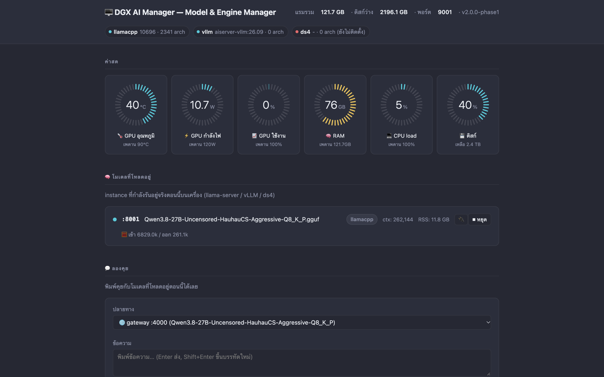
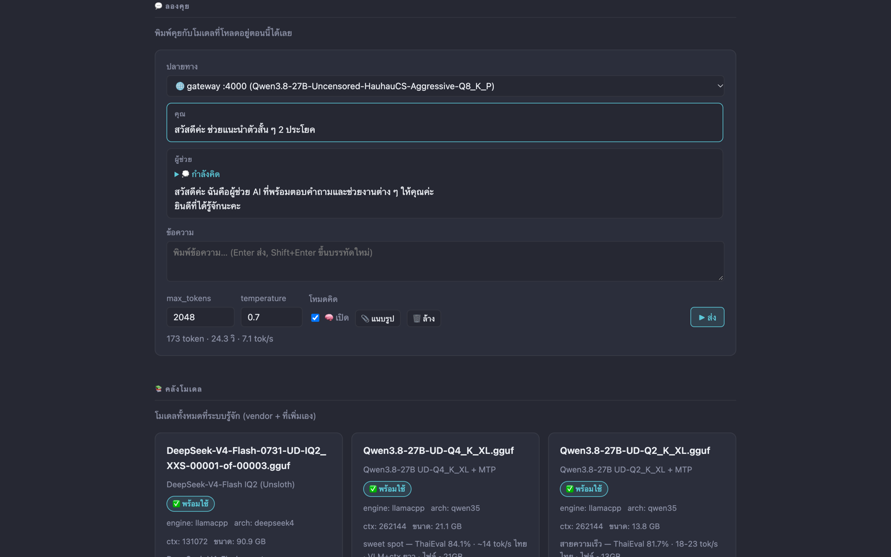
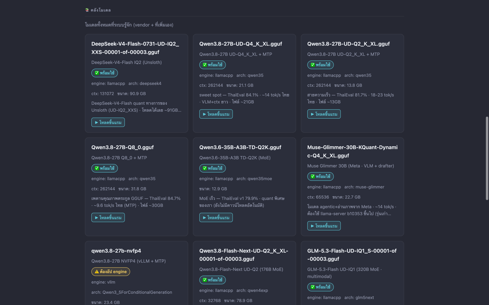
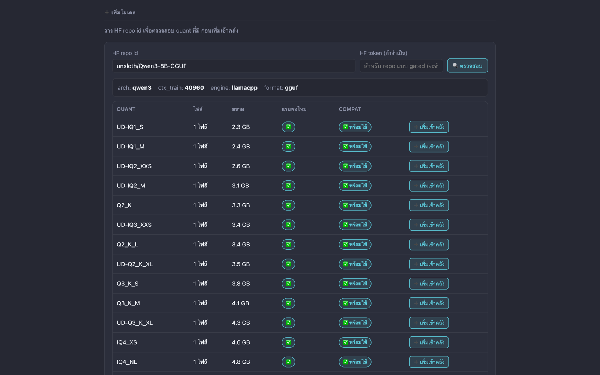
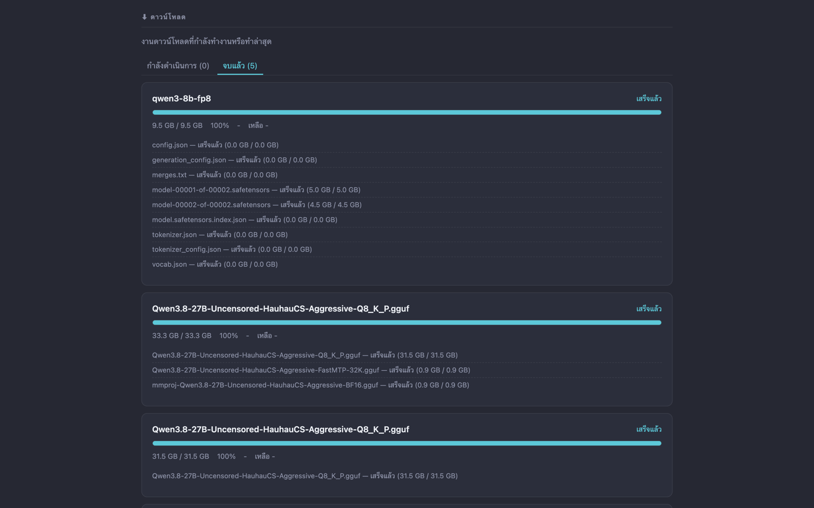

# DGX AI Manager

[ภาษาไทย](README.md) · **English**

A web-based LLM model & engine manager for the DGX Spark (GB10) — one page for everything: download models, manage your library, load them into memory, and chat right away.



## Features

### 🎛️ System dashboard
- Six live gauges across the top (CPU · RAM · GPU, etc.), styled to match DGX Spark Monitor
- Three-level gauge colours: blue ≤60% · yellow >60–80% · red >80% of max

### 🧠 Running models
- See every live instance on every port, with a stop button right on the page
- Detects speculative decoding (FastMTP) and recovers automatically when the draft model fails to load
- Pick the port (8001–8009, shown as in use / free) and context size (8K/32K/64K/128K/max presets, warns above the model's ceiling) when loading a model

### 💬 Chat playground
- Talk to a running model from the same page, with real-time streaming responses
- Collapsible "thinking" box · a switch to disable thinking mode for faster replies

### 📚 Model library
- System catalog and user-added models together in one place
- Shows file size and ready status · download or load into memory from a single card

### ➕ Add models from Hugging Face
- Paste any HF link — the app searches and resolves the repo for you
- Pick a quant with its real file size shown before you commit to downloading
- Reads the model architecture from the GGUF header via HTTP Range requests — know whether your engine can run it without downloading the whole file
- Checks engine compatibility against the actually installed engine binary, not a hand-maintained table
- 🔍 Re-inspect button on cards with a missing arch/context — reads the local file (or HF if not downloaded yet) and fills it in without touching the catalog

### ⬇ Download manager
- Download queue backed by aria2 — per-file progress, speed, and ETA
- Pause / resume / cancel mid-download
- Separate **In progress / Completed** tabs — finished jobs move over automatically, and the library card becomes ready to load into memory right away
- Clear failed downloads (error/cancelled) button to remove them from the list without deleting files on disk

### 🔌 Built-in API guide
- A modal with ready-to-copy API examples for connecting external clients

## 📸 Screenshots

### 💬 Playground
Chat with the running model · streaming · collapsible thinking box · token/s stats at the bottom



### 📚 Model library
Cards with ready status · engine/arch/ctx/size · load-into-memory button · warns when an engine upgrade is needed



### ➕ Add from Hugging Face
Enter a repo id (e.g. `unsloth/Qwen3-8B-GGUF`) → shows arch/ctx_train · every quant with size · whether RAM fits · engine compatibility



### ⬇ Download manager
In progress / Completed tabs · per-file progress



## 🚀 Usage

### Install & run
Requirements: DGX Spark (or Linux arm64 + NVIDIA GPU) · Python 3.12 · aria2 (`aria2c`) · llama.cpp `llama-server` and/or Docker (for vLLM)

```bash
git clone https://github.com/thana19/DGX-AI-Manager.git
cd DGX-AI-Manager
python3.12 -m venv .venv && .venv/bin/pip install -r requirements.txt
bash run.sh start      # starts aria2 (RPC :6800) + web on :9001
bash run.sh status     # UP / DOWN
bash run.sh stop
```

Then open `http://<DGX-host>:9001` · change the port with env `AISERVER2_PORT` · state/logs live in `~/.aiserver2/` (log: `~/.aiserver2/logs/server.log`)

### Deploy from a Mac
`bash deploy.sh` — rsyncs to `dgx:~/aiserver2` · installs deps in the venv · restarts :9001 · override with env `DGX_SSH` (ssh host, default `dgx`) and `DGX_DEST` (default `aiserver2`)

### Using the web UI
1. **Add a model** — in ➕ Add model (เพิ่มโมเดล), paste an HF repo id/link → 🔍 Check (ตรวจสอบ) → pick a quant (look at size, RAM-fit ✅ and COMPAT) → ➕ Add to library (เพิ่มเข้าคลัง) · gated repo: put an HF token in the token field
2. **Download** — track it in ⬇ Downloads (ดาวน์โหลด) · pause/resume/cancel · finished jobs move to the Completed (จบแล้ว) tab
3. **Load into memory** — in 📚 Library (คลังโมเดล) press ▶ Load (โหลดขึ้นแรม), choose port 8001–8009 and ctx (8K/32K/64K/128K/max presets) → it appears in 🧠 Running models (โมเดลที่โหลดอยู่)
4. **Try chatting** — in 💬 Playground (ลองคุย) choose the target (gateway :4000 or a direct port), type and send · toggle thinking mode (โหมดคิด) off for faster answers
5. **Stop** — press ⏹ Stop (หยุด) on the running-model card

### Call from other programs
Running models expose an OpenAI-compatible API — via the LiteLLM gateway on `:4000` or directly on the instance port (8001–8009) · press the 🔌 button on a running-model card for ready-to-copy examples. Example:

```bash
curl http://<DGX-host>:8001/v1/chat/completions \
  -H "Content-Type: application/json" \
  -d '{"model":"auto","messages":[{"role":"user","content":"สวัสดี"}]}'
```

Note: llama-server uses the full model file path as its id · `"auto"` also works

### Run tests
```bash
.venv/bin/pip install -r requirements-dev.txt
.venv/bin/pytest
```

## Supported engines

- **llama.cpp** (llama-server) — GGUF, every quant
- **vLLM** (docker) — NVFP4 with tool calling

## Under the hood

- Backend: Python 3.12 · FastAPI + uvicorn
- Frontend: a single HTML/JS file, no build step
- 253 tests that run fully offline (fixtures captured from real responses)
